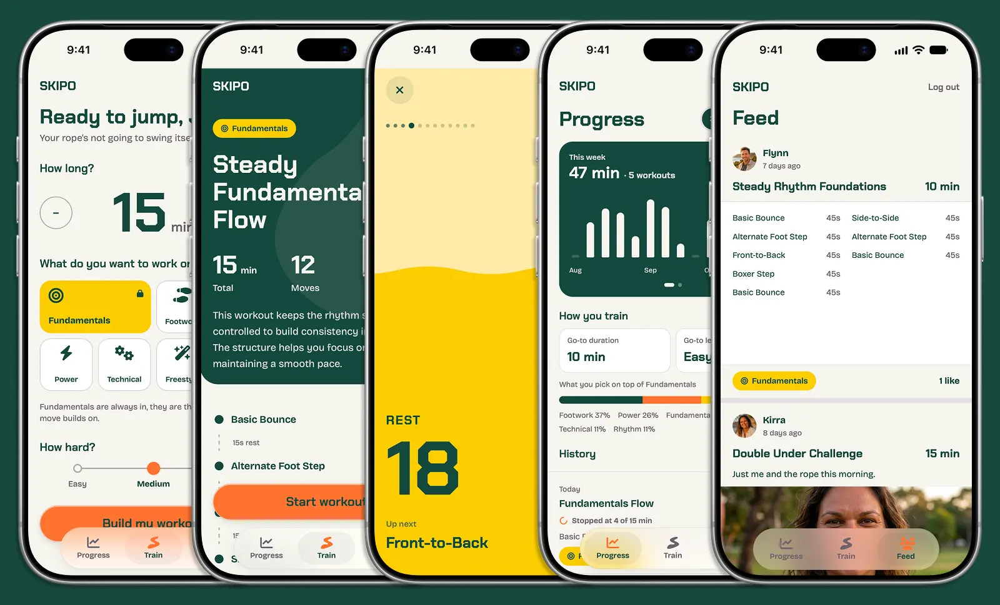

# SKIPO

AI-generated jump rope workouts, built around what you actually want to train.

**Live demo:** [SKIPO on Heroku](https://skipo-app-3be98c580ead.herokuapp.com)

Demo account: `jumper@example.com` / `letsjump`



## Why SKIPO

Every jump rope app I tried was a Tabata timer with a rope icon. I wanted workouts built around what I wanted to work on that day, so I built one. You pick a duration, the skills to focus on and a difficulty. SKIPO generates a structured workout and coaches you through it.

## What works today

- **Generate** a workout from duration, focus and difficulty (Mistral via RubyLLM)
- **Train** with work and rest timers, pause and stop
- **Progress:** weekly and monthly activity, a calendar, how you train, and full history including stopped sessions
- **Feed:** posts from other jumpers with photos, the workout's moves and like counts

**Next:** like and unlike, the workout complete screen, and sharing your own session with a photo.

## How generation works

1. **Ruby builds the frame.** Before the LLM is called, Ruby picks the allowed exercises (focus, Fundamentals, difficulty), the number of moves and the acceptable duration range. Early versions came back up to 40% off the requested length.
2. **The schema limits the output.** Exercise names are an enum of the candidates, so the model can't invent "Criss-Crosses" when the library says "Criss-Cross".
3. **Ruby repairs, then validates.** Timings within 20% get scaled back into range; anything worse, or a workout breaking the rules, is rejected.
4. **A background job runs it** (Solid Queue), retries once, and a Turbo Stream swaps the loading screen for the result or an error.

## Engineering decisions

- **One Postgres database.** Solid Cache, Queue and Cable share the primary database instead of Rails 8's separate ones, so the app runs on a single small instance.
- **Queries stay flat.** The feed loads 28 posts with authors, photos, workouts and exercises in 11 queries, using nested `includes`.
- **Plan vs attempt.** A `Workout` is the generated plan, a `WorkoutSession` is one attempt at it. Failed generations never touch the database. Data model: [schema.dbml](docs/schema.dbml), [DB.md](docs/DB.md).
- **CI on every PR:** RuboCop, Brakeman, bundler-audit, importmap audit, the test suite (Minitest) and a fresh seed run.
- **One branch and PR per card,** BEM for SCSS ([CSS.md](docs/CSS.md)). Product and design docs live in [docs/](docs).

## Stack

Rails 8.1, PostgreSQL, Devise, Turbo, Stimulus, Sass with Bootstrap, importmap, RubyLLM with Mistral, Solid Queue, Solid Cable, Solid Cache, Active Storage with Cloudinary, Minitest, GitHub Actions, Heroku.

## Run it locally

Requires Ruby 3.3.12, PostgreSQL and a Mistral API key.

```bash
git clone https://github.com/akcodepro/skipo.git
cd skipo
bin/setup --skip-server
```

Add a `.env` at the root with `MISTRAL_API_KEY=your_key`, then:

```bash
bin/dev        # start the app
bin/rails test # run the tests
bin/ci         # run the full CI pipeline
```

Uploads are stored on disk in development, so Cloudinary is only needed in production.
